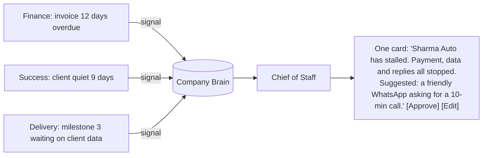

# AMFIRE HQ: a CRM run by an AI team

**Status:** Phases 0–5 built, October 2026. External channels (Razorpay, Resend email, WhatsApp Business) switch on with their keys; see `.env.example`.
**Goal:** a one-person company that runs like a team of ten. The owner spends about 10 minutes a day in HQ. Agents do the watching, drafting and chasing. The owner makes the decisions.

---

## 1. Where we are today

The admin side exists already. `/hq` is the owner workspace and `/hub` is the client workspace, and both read the same tables. What we have and what's missing:

| Area | Today | Missing |
|---|---|---|
| Leads | Discovery form → rule score → owner qualifies (`/hq/leads`) | **Where the lead came from.** The LinkedIn page button sends `utm_source=linkedin`, but `/start` throws it away, so we can't tell a LinkedIn lead from a Google one. There's also no way to add leads that arrive by LinkedIn DM, WhatsApp or referral. |
| Sales | Solution Architect agent → proposal → client accepts in Hub | No pipeline value, no follow-ups, no record of calls or messages, no win rate |
| Delivery | Projects, milestones, tasks, updates, client approvals | No time or cost tracking, no slip prediction, no weekly client update |
| Money | Milestone amounts on proposals | **Nothing:** no invoices, payments, retainers, MRR, receivables, margin or GST |
| Clients | An org with projects | No account view, health score, renewals or upsell |
| Agents | 1 agent (Solution Architect) with every run logged in `agent_runs` | No shared memory, no schedule, no hand-offs between agents |
| Owner view | "Needs your attention": a good start, built on exceptions | No daily brief, no numbers, no "ask anything" |

**The principle stays:** agents propose, the owner commits. Prices come from `knowledge/pricing.ts` and never from a model. Clients only ever see their own data. Every agent run is logged with its cost.

---

## 2. The idea: no screens full of tables

A traditional CRM is a database you have to feed and then go and read. This one works the other way round:

1. **Data comes in on its own.** It arrives from the website, the Hub, payment webhooks, tracked links and pasted messages. The owner never types into a form to keep the CRM up to date.
2. **Agents watch it all the time,** each one for its own area.
3. **Agents share one memory,** so what one agent learns changes what the others do.
4. **The owner sees one brief and one decision inbox.** Every decision comes with a draft already written, and one tap approves, edits or rejects it.
5. **Records are for drilling down,** not where you start your day.

> The test for every feature: does it take time off the owner, or add time?

---

## 3. The agent team

There are seven roles. Each one has a clear area, a list of what it may do on its own, and what needs approval. The current Solution Architect becomes one skill of the Sales agent.

| Agent | Watches | Produces | Acts alone | Needs approval |
|---|---|---|---|---|
| **Chief of Staff** | Everything other agents post | The daily brief, the decision inbox, weekly review; merges duplicates and settles conflicts between agents | Ranking, summarising, routing | — |
| **Growth** | Lead sources, LinkedIn post links, site analytics | Lead source report, "which post brought leads", LinkedIn post drafts from finished projects | Tag sources, enrich leads, draft posts | Publishing anything, using a client's name |
| **Sales** | New leads, quiet deals, client replies | Qualification notes, recommendation (Solution Architect), follow-up drafts, call prep sheets | Score, recommend, schedule reminders | Sending any message, disqualifying |
| **Deal Desk** | Accepted recommendations, change requests | Proposal drafts and change-request estimates using the rate card | Draft | Price, send (as today) |
| **Delivery** | Milestones, tasks, blockers, client approvals | Slip warnings, weekly client update drafts, "what's waiting on the client" nudges | Re-order tasks, flag risk | Messages to clients, changing due dates |
| **Client Success** | Hub activity, requests, how fast clients reply, feedback | Account health score, churn risk, upsell ideas (for example Build client → Operate retainer), renewal reminders | Score, note | Offers, discounts |
| **Finance** | Invoices, payments, retainers, project hours | Invoices due, overdue chasers, MRR, cash forecast, margin per project, GST summary | Draft invoices, reconcile payments | Sending invoices or reminders, write-offs |

Every agent has an **autonomy dial** for each action, set in HQ settings: `observe → draft → act after approval → act and report`. Everything starts at *draft*. When the owner has approved the same kind of draft without edits, say, 10 times in a row, the Chief of Staff suggests turning that action up a level. Trust is earned and can be measured.

---

## 4. How agents share knowledge: the Company Brain

This is the part that makes it a team rather than seven separate bots. There are three shared structures:

### 4.1 Signals (a blackboard)
Short, typed facts any agent can post and any agent can subscribe to:

```
signal: payment_overdue      subject: org/Sharma Auto   by: finance   data: {invoice, days: 12}
signal: client_went_quiet    subject: org/Sharma Auto   by: success   data: {last_reply_days: 9}
signal: lead_from_post       subject: post/li-2026-10   by: growth    data: {leads: 3}
```

Agents don't call each other directly. They post signals and react to them, so a new agent can join without rewiring the others.

### 4.2 Account dossier (memory for each entity)
Every lead, client and project has a living dossier: facts with a **source, a date and a confidence**. Examples: "Decision maker is the owner's son", "Prefers WhatsApp after 7pm", "Budget is tight until Diwali". A new fact replaces an old one without deleting it, so we can always see what changed and why. Every agent reads the dossier before it writes anything. That's why a follow-up from Sales already knows what Finance and Delivery know.

### 4.3 Decision inbox
Any action that needs the owner becomes **one card**: what happened, what the agent suggests, the draft ready to send, and buttons to approve, edit or reject. The Chief of Staff merges cards about the same subject.

### A worked example



Without the shared brain this is three separate alerts and three messages to the same client. With it, the owner gets one card and the client gets one message.

### Feedback loop
When the owner edits a draft, the difference is saved as a preference ("shorter", "Hinglish is fine for this client", "never mention the discount first"). Agents read these preferences before drafting, so drafts get closer to the owner's voice over time.

---

## 5. Admin (HQ): what the owner sees

```
/hq                Today: brief + decision inbox (replaces the current overview)
/hq/ask            "Ask HQ": plain-language questions over all data, answered with links to the records
/hq/pipeline       Leads and deals by stage, with value and likelihood
/hq/clients        Accounts: health, revenue to date, MRR, projects, dossier
/hq/projects       (existing) plus hours, margin, slip risk
/hq/money          MRR, invoices, receivables, cash forecast, GST
/hq/growth         Lead sources, LinkedIn attribution, content performance
/hq/agents         (existing runs) plus the team: autonomy dials, daily cost limit, signals feed
/hq/activity       (existing)
```

### The daily brief: 2 minutes to read
Written by the Chief of Staff at 8:00 IST, shown on `/hq` and emailed:

1. **Money:** cash received yesterday, overdue amount, MRR change.
2. **Pipeline:** new leads (with source), deals that moved, deals going cold.
3. **Delivery:** at-risk milestones, anything waiting on clients.
4. **Decisions:** the inbox count, most urgent first.
5. **What the team did:** "Sales drafted 3 follow-ups, Finance reconciled 2 payments, Growth found that the Oct 21 post brought 2 leads."

### The numbers that matter (and that a YC application asks for)
MRR and growth rate · pipeline value · win rate · sales cycle length · leads and revenue **by channel**, so we know whether LinkedIn works · margin per project · on-time delivery % · net revenue retention · runway / "default alive".

### Monthly investor update (automatic draft)
On the 1st, the Chief of Staff drafts the YC-style update: numbers, wins, problems, asks. The owner edits it and sends it.

---

## 6. Client Hub: what clients see

The Hub should be the reason clients stay. Additions:

| Feature | What it does |
|---|---|
| **Project concierge** | "When will the dealer app be ready?" is answered from that client's project data only, with the milestone linked. If it can't answer, it opens a "talk to a person" request. |
| **Weekly update** | Drafted by Delivery every Friday, approved by the owner, and shown in the Hub and on WhatsApp/email. |
| **Invoices and payments** | View and pay by UPI or card, with receipts and GST invoices to download. |
| **Value dashboard** | For Operate and Automate clients: hours saved, orders automated, leads handled, uptime. This is proof of ROI, and it renews retainers. |
| **Change requests** | The client describes a change, Deal Desk drafts an estimate, the owner approves it, and the client accepts. |
| **Files and decisions log** | Everything that was agreed, in one place. |
| **Feedback and referrals** | A short rating after each milestone, and a referral link with a tracked source. |

---

## 7. LinkedIn: capture, attribute, learn

LinkedIn doesn't let ordinary apps read page DMs, and page analytics through the API need LinkedIn's approval. So the plan uses what works today and adds the API later.

1. **Attribution (now).** `/start` saves `utm_*`, the referrer and the first page a visitor landed on, kept in a first-touch cookie for 30 days. Every lead gets `source = linkedin | google | whatsapp | referral | direct | …`. The LinkedIn button already sends the right UTM.
2. **A tracked link for each post.** Growth generates a short link for every post (`utm_content=<post id>`). Leads and visits are tied to the post that brought them.
3. **Quick add from a DM.** HQ gets a "paste a conversation" box. The owner pastes a LinkedIn DM or a WhatsApp chat, and Sales turns it into a lead with a dossier and a suggested reply.
4. **Content loop.** When a milestone completes, Growth drafts a LinkedIn post or case study. It asks the client for permission through the Hub before the client's name is used. Then it learns which kinds of post bring leads.
5. **Later.** LinkedIn Lead Gen Forms by webhook if we run ads. Page statistics through the Community Management API once LinkedIn approves it. Our `social_manager` project could do the publishing.

---

## 8. Data model additions

All in the `app` schema, each with its own migration.

| Table | Purpose |
|---|---|
| `leads` + columns | `source`, `utm_source/medium/campaign/content`, `referrer`, `landing_path`, `deal_value`, `stage`, `probability`, `next_follow_up_at` |
| `contacts` | People at a lead or client (role, channel they prefer) |
| `interactions` | Calls, WhatsApp, email and LinkedIn messages, meetings: logged by hand, pasted, or recorded by the system |
| `invoices`, `payments` | GST-ready invoices tied to milestones or retainers; payments matched to invoices from Razorpay webhooks |
| `subscriptions` | Operate retainers, which give us MRR |
| `time_entries` | Hours per project, so we know the margin |
| `content_posts` | LinkedIn posts with tracked links, and the leads they brought |
| `signals` | The blackboard (§4.1) |
| `memories` | Dossier facts with source, confidence and `superseded_by` (§4.2) |
| `approvals` | Decision inbox cards: agent, action, draft, status, the owner's edits |
| `agent_settings` | Autonomy dial per agent and action, daily cost limit |
| `preferences` | What we learn from the owner's edits (§4 feedback loop) |

`agent_runs`, `audit_events` and the access rules stay as they are and apply to every new agent.

---

## 9. How agents run

- **Triggers:** events (new lead, payment, client message, milestone change) plus schedules (Vercel Cron: 8:00 brief, hourly follow-up check, Friday updates, monthly investor update).
- **One runner, many roles:** a shared `runAgent(role, subject)` loads the dossier, recent signals and preferences, calls the model with tools that are only allowed to *read data or create drafts, signals and approval cards*, checks the output against a schema, and logs it in `agent_runs`. Same pattern as the Solution Architect today, including the fallback to rules.
- **Engine:** Gemini, as today, behind one interface so the model can be changed. Each agent has a cost limit; when it's reached, agents switch to rules only and say so in the brief.
- **Safety:** messages from clients and leads, and pasted text, are treated as data and never as instructions. The client concierge can read only that client's organisation. Nothing leaves AMFIRE without an approval card unless the owner has turned that action up to "act".

---

## 10. Build order

Each phase works on its own and is useful from its first day.

| Phase | What ships | Why first |
|---|---|---|
| **0: Attribution** (1–2 days) | Save lead source and UTM, quick-add a lead in HQ (LinkedIn, WhatsApp, referral), source shown on leads | Every LinkedIn lead we get without this is lost data |
| **1: Money and pipeline** | Deal stages and value, interactions, invoices, payments (Razorpay), retainers, `/hq/money`, `/hq/clients` | Agents need real numbers to reason about |
| **2: Company Brain and the first agents** | `signals`, `memories`, `approvals`, the runner, Chief of Staff (brief and inbox), Sales follow-ups, Finance chasers | This is the core: the owner's time falls the most here |
| **3: Client Hub v2** | Invoices and payment in the Hub, weekly update, concierge, change requests, feedback | Retention and getting paid on time |
| **4: Growth and intelligence** | Tracked post links, content loop, Ask HQ, Delivery and Success agents, autonomy dials, investor update | Compounding: the system learns what brings revenue |
| **5: Channels** | The brief and approvals on WhatsApp (WhatsApp Business Cloud API), voice notes turned into interactions | HQ goes wherever the owner is |

---

## 11. Decisions for the owner

1. **Payments:** Razorpay (UPI, cards, GST invoices, webhooks) is the default for India. Stripe is for USD clients later. OK?
2. **WhatsApp Business API:** needs a verified business number and Meta approval. Should we start that now (it takes time) or wait until Phase 5?
3. **Brief delivery:** email only to start, or WhatsApp as well once Phase 5 is ready?
4. **Start with Phase 0 and Phase 1?** Phase 0 is small and stops attribution data being lost today.
